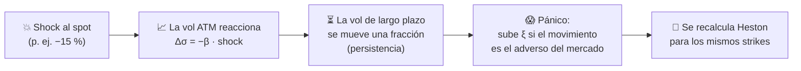

<div align="center">

# 📈 Sonrisas de Volatilidad

### Qué son, por qué existen y cómo se deforman ante eventos inesperados
**Simuladores interactivos de volatilidad implícita, local y estocástica, 100 % en el navegador**

<br>


<br>

*Black-Scholes dice "línea plana". El mercado dice otra cosa.*

</div>

---

## ✨ ¿De qué se trata?

**`sonrisa_volatilidad.html`** es una pieza didáctica **autocontenida en un solo archivo**: un recorrido en 9 secciones por la **sonrisa de volatilidad** (*volatility smile / smirk*), con **más de 10 simuladores interactivos** donde se mueven sliders, se aprietan botones ▶ y se ve en tiempo real cómo se deforma la curva.

> Black-Scholes supone una única volatilidad σ constante. Si fuera cierto, la volatilidad implícita sería una **línea plana** para todos los strikes. En la práctica dibuja una **sonrisa** (FX), una **mueca bajista** (acciones e índices) o una **mueca alcista** (commodities, *short squeeze*). Este proyecto explica por qué y deja experimentarlo.

Pensado para **estudiantes, docentes, traders y analistas de riesgo** que quieran *ver* la matemática en lugar de solo leerla.

---

## 🚀 Cómo usarlo

```bash
# 1. Descargá el archivo
git clone <url-del-repositorio>

# 2. Abrilo con cualquier navegador moderno (doble clic, o:)
open sonrisa_volatilidad.html        # macOS
xdg-open sonrisa_volatilidad.html    # Linux
start sonrisa_volatilidad.html       # Windows
```

No hay `npm install`, ni servidor, ni build, ni Python. **Es un archivo HTML.**

| Requisito | Detalle |
|---|---|
| 🌐 Navegador | Chrome, Edge, Firefox o Safari actuales |
| 📡 Internet | **Opcional.** Con conexión, las superficies 3D usan Plotly (CDN). Sin conexión, se activa un visor 3D propio |
| 🐍 Python / Node | No hacen falta |

---

## 🗺️ Mapa de contenidos

| # | Sección | Qué vas a explorar | Modelo |
|:-:|---|---|---|
| **1** | 🎯 **La idea** | Sonrisa de Merton vs. línea plana de Black-Scholes, y la **distribución implícita del precio** que está detrás | Merton + Breeden-Litzenberger |
| **2** | 🦒 **Zoológico de sonrisas** | Simétrica (FX), smirk bajista (acciones) y smirk alcista (commodities), las tres a la vez | Merton |
| **3** | ⚙️ **Volatilidad estocástica** | Cómo ρ, ξ, κ y el vencimiento moldean la curva | Heston |
| **4** | 🌐 **La sonrisa en el tiempo** | **Superficie 3D** de volatilidad (strike × vencimiento) y una sonrisa por plazo | Heston |
| **5** | 🔥 **Eventos inesperados** | Un shock de −25 % a +25 % sobre el spot y cómo reacciona la sonrisa | Heston + reacción de vol |
| **6** | 🗳️ **Eventos con fecha** | Balances, elecciones, decisiones de política: la incertidumbre concentrada en un día | Salto binario sin arbitraje |
| **7** | 📚 **Otros modelos** | Teoría de volatilidad local, estocástica y difusión con saltos | Texto |
| **8** | 🧪 **Simuladores adicionales** | Dupire, Derman–Kani, SABR y Bates | LV, árbol, SV, SV + saltos |
| **9** | ✅ **Resumen** | Ideas clave y **cuadro comparativo de modelos** | — |

---

## 🎛️ Funcionalidades

### 🖱️ Interactividad
- **Sliders** con valor en vivo para cada parámetro del modelo.
- **Botón ▶** en los parámetros clave: anima el barrido y la sonrisa *gira* sola.
- **Presets** de un clic: 📉 Acciones, 💱 FX, 🛢️ Commodities, 🗳️ Elecciones, 📊 Balance trimestral, etc.
- **Tooltips** al pasar el cursor sobre cualquier curva, con strike y volatilidad exactos.
- **Guías rápidas de controles** en cada sección: qué significa cada slider y cómo afecta la forma.

### 🌐 Superficies 3D
- Rotación arrastrando, zoom con la rueda y hover sobre los nodos.
- Renderizadas con **Plotly** (como en `superficie_dupire.html`), encuadradas para que la superficie entre completa.
- **Plan B sin internet:** visor 3D propio sobre `<canvas>` con auto-encuadre, rotación, zoom, tooltip y reinicio de la vista con doble clic.

### ⛶ Pantalla completa
- Cada gráfico tiene su botón **⛶ Pantalla completa** y su botón **✕ Salir de pantalla completa** (también funciona **Esc**).
- El gráfico se **redibuja al tamaño real** de la pantalla, sin estirarse.
- Si el navegador no permite la API de Fullscreen (algunos móviles), se expande sobre toda la ventana.

### 📱 Diseño
- Interfaz *responsive*, navegación fija con anclas por sección y gráficos SVG propios y livianos.

---

## 🧮 Modelos implementados

Todo el cálculo numérico está escrito **desde cero en JavaScript puro**, sin librerías financieras.

<table>
<tr>
<th>Modelo</th><th>Qué aporta</th><th>Implementación</th>
</tr>
<tr>
<td><b>Black–Scholes</b></td>
<td>Referencia: σ constante, línea plana</td>
<td><code>cdf</code>, <code>black</code>, <code>impliedVol</code> (inversión numérica de precios a volatilidad)</td>
</tr>
<tr>
<td><b>Merton</b> <i>(jump-diffusion)</i></td>
<td>Saltos de Poisson: colas pesadas y asimetría</td>
<td><code>mertonCall</code></td>
</tr>
<tr>
<td><b>Heston</b> <i>(vol estocástica)</i></td>
<td>Volatilidad que se mueve al azar; ρ genera el skew y ξ la curvatura</td>
<td><code>hestonCall</code> con la fórmula de Lewis sobre la función característica de Heston (1993)</td>
</tr>
<tr>
<td><b>Bates</b></td>
<td>Heston + saltos de Poisson con compensación neutral al riesgo</td>
<td><code>batesCall</code> (Heston con la función característica de saltos, 1996)</td>
</tr>
<tr>
<td><b>SABR</b></td>
<td>Sonrisa de forwards con parámetros interpretables</td>
<td><code>sabrImpliedVol</code> (aproximación de Hagan)</td>
</tr>
<tr>
<td><b>Dupire</b> <i>(vol local)</i></td>
<td>Extrae σ<sub>loc</sub>(K,T) de la superficie implícita</td>
<td><code>dupireLocalVol</code> / <code>buildDupireSurface</code> por diferencias finitas, con varianza local estabilizada en las alas</td>
</tr>
<tr>
<td><b>Derman–Kani</b></td>
<td>Árbol trinomial calibrado a la superficie</td>
<td>Construcción del árbol y comparación con la sonrisa de entrada</td>
</tr>
<tr>
<td><b>Evento binario</b></td>
<td>Salto de +a / −b el día del evento, con probabilidad calibrada para evitar arbitraje</td>
<td><code>eventoCall</code></td>
</tr>
</table>

### 📐 Constantes del mercado de referencia

```js
const S0 = 100,   // spot
      RF = 0.03,  // tasa libre de riesgo
      DIV = 0.0,  // dividendos
      T0 = 0.25;  // 3 meses
```

### 📏 Cómo se mide una sonrisa

| Concepto | Definición en el código |
|---|---|
| **Nivel (ATM)** | Vol implícita en el forward |
| **Skew (asimetría)** | `vol(90 %) − vol(110 %)`. Positivo → los puts son más caros que los calls |
| **Convexidad (sonrisa)** | `promedio(vol 90 %, vol 110 %) − vol ATM`. Positivo → ambas puntas caras |

---

## 🔥 Cómo se modela un evento inesperado (sección 5)



- **β > 0** (acciones): la vol sube cuando el precio cae.
- **β < 0** (commodities / squeeze): la vol sube cuando el precio sube.
- El gráfico muestra **antes** (gris punteado) y **después** (🔴 caída, 🟢 suba), con un rombo en el nuevo ATM.

---

## 🧱 Arquitectura del código

Un único `.html` con tres capas bien separadas:

```
sonrisa_volatilidad.html
│
├── 🎨 <style>          Diseño, tarjetas, navegación, botones, pantalla completa
├── 📝 <body>           Textos pedagógicos, guías de controles, cuadro comparativo
│                       y un <div id="w-sN"> por cada simulador
└── ⚙️ <script>
    ├── 1. Matemática   black · impliedVol · mertonCall · hestonCall · batesCall
    │                   sabrImpliedVol · dupireLocalVol · eventoCall · eventoHeston
    ├── 2. Gráficos     lineChart · heatChart · treeChart · surface3dChart
    │                   renderPlotly · attachSurface3d (visor 3D sin conexión)
    ├── 3. SECTIONS     Definición declarativa de cada simulador
    └── 4. Interfaz     mountSection (sliders, presets, ▶, pantalla completa) · boot
```

### 🧩 Los simuladores son declarativos

Agregar un simulador nuevo es describirlo, sin tocar el motor de interfaz:

```js
{
  id: 's3', charts: 1,
  controls: [
    { id: 'rho', label: 'Correlación spot-vol ρ', min: -0.95, max: 0.95,
      step: 0.05, value: -0.7, fmt: v => v.toFixed(2), play: true },
    // ...
  ],
  presets: [
    { label: '📉 Acciones (ρ = −0.7)', set: { rho: -0.7, xi: 0.5 } },
  ],
  draw(v) {
    // calcula con los valores actuales y devuelve la especificación de los gráficos
    return { charts: [{ type: 'line', title: '…', series }], info: '…' };
  }
}
```

`mountSection` construye los sliders, los presets, el botón ▶, los gráficos con sus botones de pantalla completa y el redibujado automático. Las secciones pueden depender entre sí (`deps: ['s3']`): la superficie 3D de la sección 4 se actualiza cuando cambian los parámetros de Heston de la sección 3.

### 🧪 Tipos de gráfico soportados

| `type` | Uso |
|---|---|
| `line` | Sonrisas, distribuciones, estructuras temporales (SVG propio, con hover) |
| `heat` | Mapas de calor |
| `surface3d` | Superficies 3D (Plotly, con respaldo en `<canvas>`) |
| `tree` | Árbol trinomial de Derman–Kani |

El archivo también exporta sus funciones numéricas (`module.exports`) para poder **probarlas desde Node** sin navegador.

---

## 📊 Cuadro comparativo de modelos

| Modelo | ✅ Ventajas | ⚠️ Limitaciones | 🎯 Aplicaciones típicas |
|---|---|---|---|
| **Dupire LV** | Reproduce la superficie vanilla calibrada | Sensible al ruido; dinámica futura poco realista | Exóticas dependientes de trayectoria, barreras |
| **Derman–Kani** | Intuitivo y discreto, *backward induction* | Estabilidad numérica del árbol | Americanas/exóticas y enseñanza |
| **Heston SV** | Vol aleatoria con reversión a la media; skew vía ρ | Calibración no trivial; no captura saltos extremos | Vanilla y exóticas de acciones, índices, FX |
| **SABR SV** | Parámetros interpretables, fórmulas rápidas | La aproximación falla en los extremos | Caps/floors, swaptions, futuros |
| **Merton** | Gaps y colas pesadas, parámetros claros | σ de difusión constante | Riesgo de gap y anuncios |
| **Bates** | Skew dinámico + saltos | Muchos parámetros, riesgo de sobreajuste | Productos sensibles a eventos |

> 💡 **Regla práctica:** para vanilla líquidas, primero importa calibrar bien y de forma estable. Para exóticas, además importa que la dinámica del modelo sea creíble. **Replicar hoy la sonrisa no garantiza predecir cómo evolucionará mañana.**

---

## 🎓 Ideas para llevarte

1. 📉 **Acciones e índices** → mueca bajista: se paga cobertura contra el crash.
2. 💱 **FX** → sonrisa simétrica: se temen los movimientos grandes en ambas direcciones.
3. 🛢️ **Commodities y *squeeze*** → mueca alcista: se temen las subas bruscas.
4. ⏱️ La sonrisa es **más pronunciada en plazos cortos** y se aplana al alargar el vencimiento.
5. 🗳️ Un **evento con fecha** produce una *joroba* en el ATM, no una "U".
6. 🧭 **No hay un modelo único:** cada uno responde a una pregunta distinta.

---

## 📁 Estructura del repositorio

```
.
├── sonrisa_volatilidad.html   # La aplicación completa (un solo archivo)
└── README.md                  # Este documento
```

---

## ⚠️ Aviso

Material **educativo**. Los parámetros por defecto son ilustrativos y **no constituyen una recomendación de inversión** ni reflejan datos de mercado reales.

---

<div align="center">

**Autor: Lic. Santiago Ranucci**

*Hecho con ❤️ para que la volatilidad se vea, no solo se calcule.*

</div>
